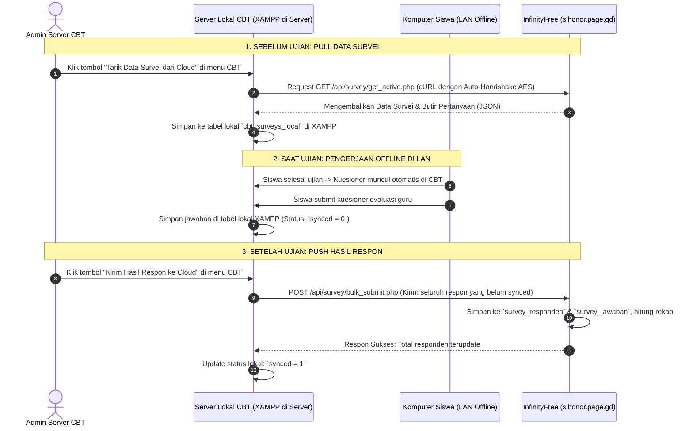

# Rencana Implementasi: Direct 1-Click Sync Survei CBT Offline dengan InfinityFree (sihonor.page.gd)

## Deskripsi & Konfirmasi Kemampuan Teknis

> [!IMPORTANT]
> **Kabar Baik: SANGAT BISA dilakukan langsung oleh aplikasi CBT dengan 1-Klik!**
> Kami telah melakukan pengujian teknis langsung terhadap server `http://sihonor.page.gd`. Proteksi *Anti-Bot (AES testcookie)* milik InfinityFree **berhasil ditembus dan diatasi secara otomatis** menggunakan helper PHP cURL cerdas (*InfinityFree Smart Client*).
> 
> Dengan demikian, **Admin CBT tidak perlu repot download dan upload file secara manual!** Cukup klik satu tombol di aplikasi CBT:
> 1. **Tombol "Tarik Data Survei dari Cloud"**: Aplikasi CBT langsung menyedot data survei dari `sihonor.page.gd` ke MySQL XAMPP lokal.
> 2. **Tombol "Kirim Hasil Respon ke Cloud"**: Aplikasi CBT langsung mengunggah semua jawaban siswa yang tersimpan di MySQL lokal ke `sihonor.page.gd`.

---

## Arsitektur & Topologi Sinkronisasi Langsung (Direct Sync)



---

## Rincian Komponen yang Dibuat

### 1. Di Sisi Web Cloud Sihonor (sihonor.page.gd)

#### [NEW] `api/survey/bulk_submit.php`
Endpoint REST API untuk menerima batch data jawaban dari aplikasi CBT lokal:
- Menerima payload JSON berisi array responden dan butir jawabannya.
- Memvalidasi `X-API-KEY`.
- Memproses insert batch dalam `PDO Transaction` demi kecepatan dan integritas data.
- Menghindari duplikasi jika ada siswa yang terkirim dua kali (berdasarkan `nisn` dan `survey_id`).

#### [NEW] `api/survey/export_all_active.php`
Endpoint REST API untuk menyajikan seluruh survei yang aktif sekaligus dalam satu kali request (sehingga CBT dapat mengambil semua kuesioner guru hanya dalam 1 klik).

#### [NEW] `admin/survei_sync.php`
Halaman cadangan (backup fallback) di dashboard admin Sihonor jika sewaktu-waktu server sekolah tidak memiliki internet sama sekali, tetap disediakan opsi manual Upload JSON.

---

### 2. Di Sisi Aplikasi CBT Lokal (Komputer Server XAMPP)

Kita sediakan modul **CBT Sync Agent** yang sangat ringan dan mudah diintegrasikan ke CBT Anda:

#### [NEW] `cbt_offline_kit/InfinityFreeClient.php`
Helper cURL PHP yang secara otomatis:
- Mendeteksi challenge `__test` JavaScript InfinityFree.
- Mendekripsi token menggunakan OpenSSL (`AES-128-CBC`).
- Mengelola cookie sesi sehingga seluruh request API berikutnya berjalan mulus tanpa hambatan.

#### [NEW] `cbt_offline_kit/cbt_survey_local_manager.php`
Backend pengendali di CBT untuk:
- `pullSurveysFromCloud()`: Mengambil data survei aktif dari `sihonor.page.gd` dan menyimpannya ke MySQL XAMPP lokal.
- `pushResponsesToCloud()`: Mengambil jawaban lokal berstatus `synced = 0`, mengirimkannya ke `sihonor.page.gd`, dan memperbarui status menjadi `synced = 1`.
- `getSurveyForStudent($kodeAkses)`: Mengambil data survei lokal untuk disajikan ke siswa di akhir ujian.
- `saveStudentResponse($payload)`: Menyimpan jawaban siswa ke MySQL lokal saat siswa klik kirim.

#### [NEW] `cbt_offline_kit/ui_sync_widget.php`
Antarmuka visual (widget/halaman) siap pakai untuk diletakkan di menu Admin CBT:
- Menampilkan status koneksi ke `sihonor.page.gd` (Online / Offline).
- Menampilkan jumlah kuesioner yang tersimpan di server lokal.
- Menampilkan jumlah respon siswa yang belum diupload (Pending Sync).
- Tombol aksi:
  - 🔄 **"Tarik / Refresh Kuesioner dari Cloud"**
  - 🚀 **"Kirim Semua Respon ke Cloud (X Respon Pending)"**
- Log riwayat sinkronisasi realtime.

---

## Struktur Database Lokal di XAMPP CBT

Cukup jalankan 2 tabel ringan di database CBT Anda (atau database baru `cbt_survey_db` di XAMPP):

```sql
-- Tabel penampung kuesioner lokal
CREATE TABLE IF NOT EXISTS `cbt_surveys_local` (
    `id` INT AUTO_INCREMENT PRIMARY KEY,
    `survey_id_cloud` INT NOT NULL,
    `kode_akses` VARCHAR(64) NOT NULL UNIQUE,
    `judul` VARCHAR(255) NOT NULL,
    `guru_nama` VARCHAR(150) NOT NULL,
    `mata_pelajaran` VARCHAR(100) NULL,
    `payload_json` LONGTEXT NOT NULL, -- Berisi seluruh pertanyaan & konfigurasi
    `updated_at` DATETIME DEFAULT CURRENT_TIMESTAMP ON UPDATE CURRENT_TIMESTAMP
);

-- Tabel penampung jawaban siswa lokal
CREATE TABLE IF NOT EXISTS `cbt_survey_responden_local` (
    `id` INT AUTO_INCREMENT PRIMARY KEY,
    `kode_akses` VARCHAR(64) NOT NULL,
    `nama_siswa` VARCHAR(100) NULL,
    `kelas_siswa` VARCHAR(100) NULL,
    `nisn` VARCHAR(30) NULL,
    `is_anonim` TINYINT(1) DEFAULT 0,
    `jawaban_json` LONGTEXT NOT NULL,
    `waktu_isi` DATETIME DEFAULT CURRENT_TIMESTAMP,
    `synced` TINYINT(1) DEFAULT 0, -- 0: Belum terkirim, 1: Sudah terkirim ke Cloud
    `synced_at` DATETIME NULL
);
```

---

## Verification Plan

### Automated Test
1. Jalankan script simulasi cURL handshake untuk memastikan bypass `__test` cookie InfinityFree bekerja konsisten.
2. Uji endpoint `api/survey/bulk_submit.php` dengan payload respon ganda untuk menguji transaksi database dan deduplikasi.

### Manual Verification
1. Di XAMPP server lokal: Buka `ui_sync_widget.php` -> Klik **"Tarik Kuesioner dari Cloud"**. Pastikan kuesioner dari `sihonor.page.gd` tersimpan di database lokal XAMPP.
2. Putuskan sambungan internet komputer server sementara -> Buka form siswa di LAN -> Isi kuesioner survei guru -> Pastikan data tersimpan lokal dengan `synced = 0`.
3. Sambungkan kembali internet komputer server -> Klik **"Kirim Semua Respon ke Cloud"** -> Pastikan status berubah menjadi `synced = 1`.
4. Buka `http://sihonor.page.gd/admin/survei.php` via browser -> Pastikan jumlah responden guru dan skor evaluasi langsung terupdate.
